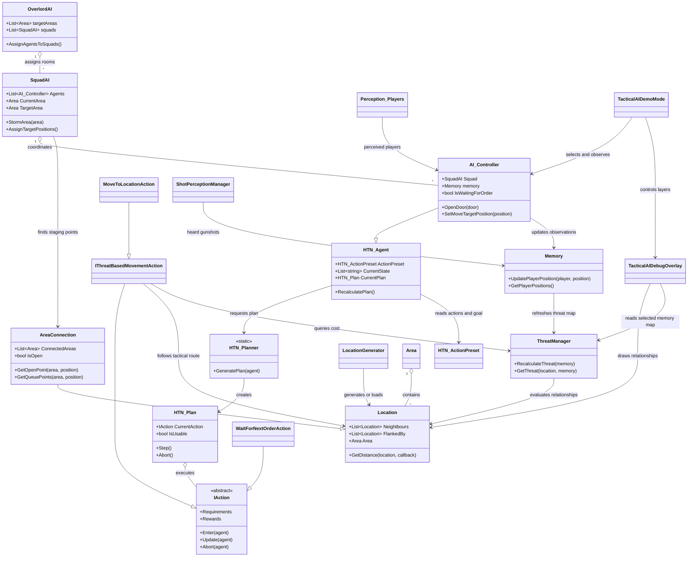
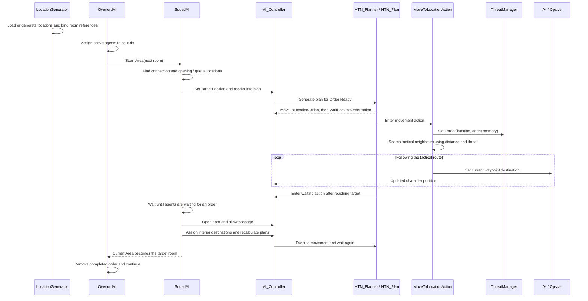

# Tactical AI Prototype

> This page documents the prototype's architecture, implementation, and verified behaviour. The Unity project combines custom AI systems with A* Pathfinding, Opsive's Ultimate Character Controller, Odin Inspector, and third-party environment assets. The contribution descriptions below refer to the project's systems as a whole.

## Squad coordination and tactical navigation in Unity

> **One-line pitch:** A Unity prototype in which NPC squads coordinate room entry, plan actions from goals, and navigate using generated cover relationships and remembered threats.

The project connects several levels of decision-making: an overall room order, a squad's entry procedure, an individual agent's action plan, and movement through the environment. A generated location graph describes useful positions and their relationships, while perception and memory provide the context for estimating danger.

## Recruiter summary

This is a project I made during my time at the university of Applied sciences Salzburg back in 2023 for a Game-AI competition. It combines gameplay AI, spatial reasoning, character-controller integration, and runtime debugging. The central engineering challenge is coordinating decisions across different timescales: a squad must assemble and wait together, while each character continuously follows a path, reacts to nearby agents, and updates its knowledge of the world.

The prototype demonstrates:

- a custom action planner with Boolean requirements, effects, and explicit cancellation;
- squad formation, doorway staging, and coordinated movement into rooms;
- generation and reuse of tactical locations, including cover, peek, and flank relationships;
- route selection that combines travel distance with threats derived from an agent's memory;
- visual perception, movement-based hearing, and gunshot notifications;
- integration with A* navigation and the Opsive character and weapon systems;
- runtime debug overlays and a reversible observer camera that work in player builds;

## Table of contents

- [1. Why this project](#1-why-this-project)
- [2. Questions behind the prototype](#2-questions-behind-the-prototype)
- [3. What was built](#3-what-was-built)
- [4. Engineering contributions](#4-engineering-contributions)
- [5. Methodology and results](#5-methodology-and-results)
  - [Evaluation dimensions and their results](#evaluation-dimensions-and-their-results)
  - [Scope of the evidence](#scope-of-the-evidence)
- [6. Technical architecture](#6-technical-architecture)
  - [System overview](#system-overview)
  - [UML class diagram](#uml-class-diagram)
  - [Runtime sequence](#runtime-sequence)
- [7. Implementation details](#7-implementation-details)
  - [Main code areas](#main-code-areas)
  - [Tactical locations and room connections](#tactical-locations-and-room-connections)
  - [Perception, memory, and threat](#perception-memory-and-threat)
  - [Action planning and execution](#action-planning-and-execution)
  - [Squad coordination and movement](#squad-coordination-and-movement)
  - [Observer mode and runtime visualization](#observer-mode-and-runtime-visualization)
  - [Build support and validation tooling](#build-support-and-validation-tooling)
  - [Data and control flow](#data-and-control-flow)
- [8. Running the demo and what to expect](#8-running-the-project-and-demo)

## 1. Why this project

Most modern enemy NPCs in video games feel a little bit dull. So I asked myself a simple question: "Is it that hard to program a more tactically sound AI?". So I set out to create my own small tactical AI and defined the few following, for me relevant, factors. Moving an NPC to a destination is only one part of tactical behaviour. A squad also needs to decide where to assemble, who occupies each position, when everyone is ready, and when a doorway can be crossed. Those decisions depend on information that a basic walkable navigation graph does not describe directly.

The prototype explores three connected problems:

1. **Giving positions tactical meaning.** A reachable point can be exposed, useful for peeking, protected by cover, or connected to another room.
2. **Coordinating individual agents.** Characters need their own movement and action state while still participating in a shared room-entry procedure.
3. **Making decisions inspectable.** Navigation, threat estimates, and waiting states need to be visible while the simulation runs, including when presenting an executable outside Unity.

The resulting system represents room structure, tactical locations, perceived enemies, and action state explicitly so that each layer can be inspected and adjusted.

## 2. Questions behind the prototype

- **Spatial reasoning:** Can useful cover, peek, and flank relationships be generated from scene geometry and reused at runtime?
- **Planning:** Can a small action vocabulary translate a squad order into movement and waiting behaviour, with clear handling of cancellation and failure?
- **Coordination:** Can agents stage at a doorway and proceed together while resolving local movement conflicts?
- **Tactical movement:** Can remembered enemy positions influence the cost of a route through the location graph?
- **Presentation:** Can the same scene support normal play and an observer demonstration with debug information visible in a build?

The implementation provides mechanisms for these questions. The validation results below establish the behaviour that has actually been checked.

## 3. What was built

The project connects environment analysis, perception, planning, and movement:

```text
Scene geometry + A* navigation graph + room volumes
    -> Generated or preloaded tactical locations
    -> Neighbour, door, cover, peek, and flank relationships

Visual and hearing checks + gunshot notifications
    -> Agent memory
    -> Threat values for tactical locations

Ordered room targets
    -> Squad staging and entry orders
    -> Individual action plans
    -> Tactical route selection
    -> A* path following + Opsive character movement

Runtime state from these systems
    -> Observer camera + selectable debug overlays
```

The demonstrated active `v4_Enemy` action preset contains `MoveToLocationAction` and `WaitForNextOrderAction`, with **`Order Ready`** as its goal. This configuration demonstrates squad movement and synchronization. Earlier presets and action versions retain combat, pursuit, and area-management experiments.

## 4. Engineering contributions

| Challenge | Implemented approach | What this demonstrates |
| --- | --- | --- |
| Give navigation points tactical meaning | `LocationGenerator` samples and refines positions, checks visibility, and records neighbour, cover, peek, and flank relationships. | Spatial reasoning, geometry queries, reusable environment data |
| Coordinate a shared objective | `OverlordAI` assigns room orders; `SquadAI` stages agents, waits for readiness, opens a door, and assigns interior destinations. | Multi-agent coordination, state transitions, coroutine orchestration |
| Turn goals into executable behaviour | `HTN_Planner` searches over action requirements and effects; `HTN_Plan` manages action execution and cancellation. | Planning algorithms, action lifecycle design, failure handling |
| Use incomplete knowledge when moving | `Memory` stores enemy observations; `ThreatManager` maps them to location costs used by tactical movement actions. | Per-agent knowledge, cost modelling, perception-to-action integration |
| Connect tactical decisions to characters | `AI_Controller` supplies destinations and interfaces with A* navigation, Opsive locomotion, aiming, inventory, and door interaction. | Integration across gameplay systems |
| Explain AI behaviour in a build | `TacticalAIDemoMode` provides a flying camera; `TacticalAIDebugOverlay` draws runtime geometry and labels. | Debug tooling, rendering, reversible control handover |

The custom code supplies tactical reasoning, coordination, and observation tools. A* supplies the underlying navigation infrastructure; Opsive supplies the character-controller and weapon framework; Odin supports Inspector tooling and serialized data structures. Environment and character assets provide the presentation and test setting.

## 5. Methodology and results

1. **Represent the environment.** Define room volumes and connections, then generate or load tactical locations and their relationships.
2. **Connect perception to knowledge.** Use visibility, movement, and gunshot events to update an agent's remembered enemy positions.
3. **Connect orders to movement.** Give squads an ordered room route and let individual action plans execute the destinations assigned during staging and entry.
4. **Inspect the running system.** Use the observer camera to display navigation, paths, locations, room structure, and selected-agent information.

### Evaluation dimensions and their results

| Dimension | Check | Recorded result |
| --- | --- | --- |
| Planner and supporting logic | Missing and impossible plans, cancellation, completion, memory, empty rosters, and preset type resolution | **17 regression checks passed.** |
| Scenario setup | Agents, queued orders, and loaded tactical locations | The scene smoke test recorded **2 active agents**, **7 room orders**, and **2,414 locations**. |
| Squad progression | Movement and completion of the first room order | Both agents moved; the order count decreased from **7 to 6** by the smoke test's **20-second** sample, with **0 runtime errors**. |
| Multiple Agents | Number of active agents, plans including multiple agents, completion | The system was tested with up to **5 active agents** working together simultaniously as a squad |
| Editor observer lifecycle | Entry, exit, cursor, HUD, cameras, audio, repeated toggles, and component disabling | Demo validation passed, including restoration of the editor scene setup. |

### Scope of the evidence

These results establish functional behaviour in the supplied scenario. The 20-second observation describes that run's progression; it is not a benchmark of planner speed or a measure of tactical quality. The complete seven-room route, larger squad populations, and comparative performance or believability studies have not been validated by these checks.

## 6. Technical architecture

### System overview

The runtime is organized into five cooperating areas:

- **World representation:** `LocationGenerator`, `Location`, `Area`, `AreaConnection`, and the `Locations` spatial index describe positions, relationships, and rooms.
- **Perception and knowledge:** `Perception_Players`, `ShotPerceptionManager`, `Memory`, and `ThreatManager` turn observations into remembered positions and location threat values.
- **Coordination and planning:** `OverlordAI`, `SquadAI`, and the `HTN_*` classes turn room orders into agent actions.
- **Execution:** `AI_Controller`, movement actions, A*, Opsive, and `SimpleAvoidanceManager` carry out those actions.
- **Observation and validation:** The demo controller, overlay renderer, and validation tools expose and check runtime behaviour.

### UML class diagram

The diagram highlights the active squad scenario and its principal dependencies. It omits older action variants and most third-party implementation details.



### Runtime sequence

This sequence follows one room order through the active movement-and-wait preset. Perception and memory continue updating alongside it.



## 7. Implementation details

### Main code areas

| Code area | Responsibility |
| --- | --- |
| `Assets/Scripts/OverlordAI.cs` and `SquadAI.cs` | Agent grouping, ordered room objectives, doorway staging, and entry progression |
| `Assets/Scripts/AI/HTN/` | Planner, agent state, action presets, plan execution, and action lifecycle |
| `Assets/Scripts/AI/Actions/v4/` | Tactical route search, movement, room-entry variant, and waiting |
| `Assets/Scripts/LocationSystem/` | Location generation, room membership, door connections, and tactical relationships |
| `Assets/Locations.cs` | Octree-based location lookup and nearest-location queries |
| `Assets/ThreatManager.cs` | Threat maps indexed by agent memory and tactical location |
| `Assets/Scripts/AI/AI_Controller.cs` | Planning, perception, navigation, and character-system integration |
| `Assets/Scripts/AI/Memory.cs`, perception classes, and `ShotPerceptionManager` | Remembered targets, sight/hearing checks, and shot events |
| `Assets/Scripts/TacticalAIDemoMode.cs`, `TacticalAIDebugOverlay.cs`, and `Assets/Shaders/TacticalAIDebug.shader` | Observer controls, debug meshes, labels, and depth testing |
| `Assets/Editor/` and `TacticalAIDemoPlayerValidation.cs` | Editor checks, build tooling, and opt-in standalone validation |

### Tactical locations and room connections

`LocationGenerator` samples positions inside a scan volume and projects candidates onto walkable A* graph nodes. Low and high geometry tests help identify useful positions near obstacles. Further refinement and visibility checks construct relationships between locations:

- **Neighbours** connect positions that can be used by the tactical route search.
- **Flank and standing-exposure relationships** describe positions with relevant lines of sight.
- **Peek and cover directions** associate other locations with local offsets.
- **Area connections** link rooms and supply door-opening and queue positions.

The resulting graph can be saved as a prefab in the Editor. The demo references that prefab through `PreloadedLocations`, loads it at runtime, and reconnects its locations to the scene's room volumes. This allows a player build to reuse the generated data.

`Locations` indexes the loaded points in an octree. `Location.GetDistance` requests A* path lengths and caches the results. These travel distances are used when evaluating tactical routes.

### Perception, memory, and threat

`Perception_Players` checks active objects tagged `Player`. Its base `Perception` class provides a vision cone, range checks, and raycasts at several target heights. Movement-based hearing compares the target's speed with its distance. `ShotBroadcaster` separately forwards weapon events to `ShotPerceptionManager`, which updates nearby listeners' memories.

`Memory` stores the last known position, observation time, and area identifier for each remembered target. `AI_Controller` updates observations and can discard a remembered position when it becomes visible without the target being detected there. Inactive targets are removed from memory.

`ThreatManager` maintains a separate location-to-threat map for each `Memory`. It associates remembered enemy positions with nearby locations, then propagates contributions through flank, standing, peek, and cover relationships. The current constants give cover relationships zero added threat and the other relationship types positive weights.

This makes threat depend on an agent's knowledge. An observer may see no threat overlay when the selected agent has no remembered enemies, especially while the human player is suspended in demo mode.

### Action planning and execution

The planner is named `HTN_Planner` in the code. Its search works backward from a desired set of Boolean flags through actions' `Requirements` and `Rewards`, with a search-depth limit of ten. Candidate actions are ranked by their relationship to the remaining goals; the resulting action order is reversed for execution.

`HTN_ActionPreset` defines the available actions and goal flags. For the current squad preset, the essential chain is:

```text
Goal: Order Ready
    -> WaitForNextOrderAction requires Target Reached
    -> MoveToLocationAction supplies Target Reached

Execution: move to the assigned location -> wait for the next order
```

`HTN_Plan` steps through the actions. `IAction` separates entry, update, successful completion, cancellation, and cleanup. Successful completion applies state effects; aborting invalidates the remaining plan. When a squad issues a new destination, it explicitly requests replanning so an old waiting action does not retain control.

Although its name begins with `I`, `IAction` is an abstract base class. The same is true of `IThreatBasedMovementAction`.

### Squad coordination and movement

`OverlordAI` groups active characters into squads of up to four and dispatches the ordered target areas. `SquadAI` manages preparation and entry: it finds a suitable connection, directs agents toward staging positions, waits for their waiting actions, opens the door if needed, and assigns distinct interior locations.

`IThreatBasedMovementAction` searches the tactical location graph. Its cost combines accumulated travel distance, a weighted threat contribution, and an estimated remaining travel distance. Once it has a route, it supplies successive destinations to the agent's A* movement component. Path requests have a timeout, and request identifiers prevent a replaced path request from installing an obsolete result.

`SimpleAvoidanceManager` supplies local yielding positions based on agent priorities and passive/VIP state. This is a separate concern from the route through tactical locations: one chooses where to go, while the other helps agents move around each other locally.

### Observer mode and runtime visualization

`TacticalAIDemoMode` adds an Inspector checkbox and an **F8** runtime switch. Entering observer mode suspends the human player, other scene cameras, camera handlers, audio listeners, and screen-space HUD canvases. A dedicated spectator camera then supplies free movement and an immediate-mode control panel. Exiting restores the previous enabled states and cursor configuration.

`TacticalAIDebugOverlay` builds coloured triangle and line meshes and submits them to the spectator camera through `Graphics.DrawMesh`. Agent labels use screen-space GUI drawing. The scene references the debug shader directly so it is included in the player build.

The selectable layers cover:

| Layer | Information shown |
| --- | --- |
| Navigation surface and graph edges | Walkable graph geometry and graph boundaries or connections |
| Tactical locations and neighbours | Generated points and their local connectivity |
| Cover, peek, and flank links | Relationships for the location nearest the selected agent |
| Paths and targets | Navigation paths, tactical waypoints, and assigned destinations |
| Vision and hearing | Vision cones and gunshot hearing ranges |
| Threat and enemy memory | Selected-agent threat values and remembered enemy positions |
| Rooms and doors | Room bounds, connections, and door state |
| Agent labels | Names, health, and current actions |

**All** and **None** switch the layers together. A depth-test option shows debug geometry through walls. Nearby world geometry is filtered by a configurable radius, line meshes have a vertex budget, and cached geometry refreshes at intervals. These measures bound some of the debug work; their effect on large scenarios has not been benchmarked.

### Build support and validation tooling

Action presets retain runtime type names alongside their editor script references. `link.xml` preserves action types instantiated through reflection. Editor-only asset loading and prefab-saving code is guarded, while preloaded location data and the debug shader have serialized references.

The **Tools > Tactical AI** menu exposes the following checks:

| Tool | Purpose |
| --- | --- |
| Run Regression Checks | Checks planner lifecycle, memory handling, empty rosters, and existing action presets. |
| Compile Player Scripts | Compiles Windows player assemblies without relying on editor APIs. |
| Run Scene Smoke Test | Opens the tactical scenario temporarily and checks movement and first-room progression. |
| Validate Demo Mode | Exercises observer entry/exit, restored state, overlay generation, repeated toggles, and AI progress in Play Mode. |
| Build Demo Validation Player | Builds a Windows development executable containing an opt-in runtime check. |

The standalone check compares captured camera output with overlays enabled and disabled, checks player restoration, and observes AI progression. It renders into a texture so the check can also run with a hidden window. Save open scenes before running tools that open or build the test scenario.

### Data and control flow

Two related paths meet in tactical movement:

```text
Perception -> Memory -> ThreatManager
                            |
                            v
Room order -> Squad destinations -> Action plan -> Tactical location route
                                                       |
                                                       v
                                        A* navigation -> Character movement
```

The observer reads the current agents, paths, locations, and threat maps to visualize them. Its drawing code does not assign orders or change threat costs.

## 8. Running the demo

In this folder you will find a `TacticalAIDemo.zip` file. Just unpack it and try it out for yourself. The demo is there to visualize the systems working together. As AI is pretty hard to show in a gameplay environment, so I opted to show it in a "debug-way".

The demo uses two agents, out of performance constraints while visualizing, as I did not have a lot of time to optimize the performance. Their overarching order is to enter and secure the house. Both agents are going to position themselfes to make entry, cover eachother and clear the house step-by-step. Using the panel on the left you will be able to en- and disable the visualization of different planning factors for the Agents. The Agents are programmed to not engage the player character for presentation purposes.

### Observer controls

| Control | Action |
| --- | --- |
| **F8** | Switch between regular play and observer mode |
| **Right mouse button** | Hold to look and fly; release to use the panel |
| **W / A / S / D** | Move while holding right mouse |
| **Q / E** | Descend / rise while holding right mouse |
| **Shift** | Increase movement speed |
| **Mouse wheel** | Adjust flight speed outside the panel |
| **F** | Focus the selected agent |
| **Tab** | Select the next agent |
| **F1** | Show or hide the panel |
| **Escape** | Release the mouse look |
