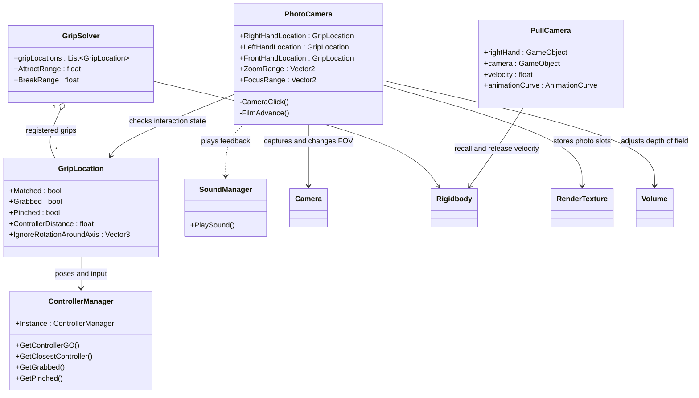
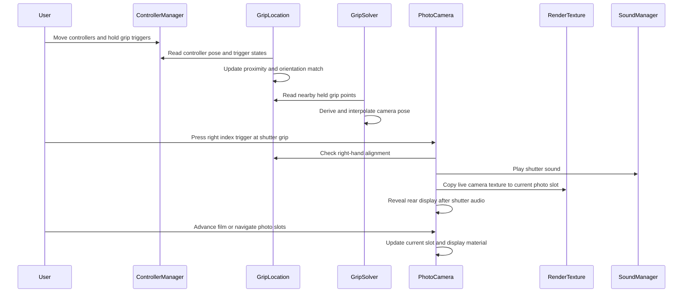

# VR Analog Camera Safari

> A team project I developed together with a friend of mine, it was developed during my time at the University of applied sciences Salzburg. The final demo video, Android build, and evaluation reports are available in this repository.

## Physical camera interactions in virtual reality

> **One-line pitch:** We built a Unity prototype in which users operate a virtual analog camera with Meta Quest 3 controllers, using two-handed grips, lens rotation, and film controls to photograph wildlife in a safari environment.

The project explores how familiar physical gestures can make virtual objects easier to understand and more satisfying to use. Users can catch and hold the camera, adjust zoom and focus, take pictures, and review them on its rear display. We developed the prototype through two rounds of user feedback, with particular attention to hand placement and the discoverability of camera controls.

## Recruiter summary

This project combines C# gameplay programming, VR interaction design, 3D transformation math, rendering, and physics. The central engineering challenge was to make a single virtual object respond coherently to two tracked controllers while keeping its shutter, lens, and film interactions usable.

The prototype demonstrates:

- a custom grip solver for one-handed and two-handed camera handling;
- controller pose matching and proximity-based interaction points;
- twist-based zoom and focus controls;
- render-texture photo capture and circular photo navigation;
- camera recall, throwing, and release velocity handling;
- coordinated mechanical audio, display feedback, and lever animation; and
- usability testing that informed changes to handling and onboarding.

As this was a small project implemented by only two people it is very hard to assign individual contributions as a lot of code was also written in pair programming.

## Table of contents

- [1. Why we made this project](#1-why-we-made-this-project)
- [2. Questions we wanted to answer](#2-questions-we-wanted-to-answer)
- [3. What we built](#3-what-we-built)
- [4. Our engineering contribution](#4-our-engineering-contribution)
- [5. Methodology and results](#5-methodology-and-results)
  - [Evaluation dimensions and their results](#evaluation-dimensions-and-their-results)
- [6. Technical architecture](#6-technical-architecture)
  - [System overview](#system-overview)
  - [UML class diagram](#uml-class-diagram)
  - [Runtime sequence](#runtime-sequence)
- [7. Implementation details](#7-implementation-details)
  - [Main code areas](#main-code-areas)
  - [Repository structure](#repository-structure)
  - [Running the project](#running-the-project)
  - [Scope and remaining improvements](#scope-and-remaining-improvements)

## 1. Why we made this project

An analog camera invites physical interaction: holding its body steady, turning the lens, pressing the shutter, and advancing the film. In VR, users hold controllers without a physical camera body to guide their hands. Recreating those actions therefore requires more than mapping buttons to camera functions.

We focused on three practical problems:

1. **Hand placement needs support.** Small interaction areas are difficult to find without a physical object guiding the user's grip.
2. **Two hands must control one object.** Both controller poses need to contribute to stable camera handling while allowing the user to manipulate the lens.
3. **Realistic actions need to be discoverable.** An interaction can feel natural once explained while still being difficult to find independently.

The safari environment gives users subjects to photograph while exploring those interactions.

## 2. Questions we wanted to answer for ourselfes

- **Perceived realism:** Can Meta Quest 3 controllers provide feedback that makes interacting with a virtual object feel more realistic?
- **Interaction design:** Which hand movements feel intuitive when handling and operating an analog camera in VR?

## 3. What we built

The prototype connects controller input to camera handling, rendering, and feedback:

```text
Tracked controller poses and button input
        -> Grip matching and camera pose solving
        -> Shutter, film, zoom, and focus interactions
        -> Camera rendering and photo slots
        -> Rear display, lever animation, and audio feedback
```

| Interaction | User action and resulting behaviour |
| --- | --- |
| Recall | Press **A** on the right controller to pull the camera toward the right hand, then catch it. |
| Hold | Grip near the interaction points to hold the camera with one or both controllers. |
| Capture | Align the right controller with the shutter grip and press its index trigger to capture a photo. |
| Advance film | While aligned with the right-hand grip, push the right thumbstick right to animate the lever and clear the next photo slot. |
| Review / rewind | While aligned with the left-hand grip, rotate the left thumbstick in a circle to navigate photo slots. |
| Zoom | Hold the front lens grip with the grip trigger and twist the controller to change field of view. |
| Focus | Hold the front lens interaction with the index trigger and twist the controller to adjust depth of field. |

An instruction sign near the starting position explains the controls. The custom interaction system uses tracked controller poses and buttons.

## 4. Our engineering contribution

| Challenge | Implemented approach | What this demonstrates |
| --- | --- | --- |
| Hold one object with two controllers | `GripSolver` derives target camera poses from local/world transformation matrices, averages contributing poses, and interpolates the result. | 3D math, pose coordination, interaction programming |
| Identify usable interaction points | `GripLocation` checks controller proximity and orientation; `ControllerManager` supplies poses and trigger states. | Spatial input handling, component design |
| Translate lens gestures into camera controls | `PhotoCamera` maps controller rotation to field of view and URP depth-of-field settings. | Gesture mapping, rendering integration |
| Capture and review photos in VR | Render textures store images in a circular buffer and feed a rear-display material. | GPU texture operations, bounded storage, visual feedback |
| Recall and release a physical object | `PullCamera` controls approach velocity and restores estimated movement velocity on release. | Rigidbody integration, motion estimation |
| Improve usability through observation | Two feedback rounds informed the custom grip solver, additional camera controls, and instruction sign. | Iterative development, qualitative evaluation |

## 5. Methodology and results

1. **Build a proof of concept.** Implement camera recall, capture, and film advancement.
2. **Observe initial use.** Test with four participants using observation, think-aloud feedback, and a questionnaire.
3. **Address handling problems.** Introduce custom two-handed handling and grip alignment, then add zoom, focus, and film/photo navigation.
4. **Evaluate the revised experience.** Gather feedback from four participants through observation, think-aloud sessions, and follow-up questions.
5. **Improve onboarding.** Add an instruction sign after participants struggled to discover the advanced interactions.

### Evaluation dimensions and their results

| Dimension | Observed result | Implication |
| --- | --- | --- |
| Two-handed handling | The final report describes easier camera handling and quicker initial photo capture after the custom solver was introduced. | Supporting familiar hand placement helped the basic interaction. |
| Recall and catching | The final round no longer recorded the earlier complaints about catching the recalled camera. | The revised handling appeared to help camera retrieval as well. |
| Feature discovery | Participants often needed explanations before using film controls, zoom, and focus. | Physical familiarity alone did not communicate every available action. |
| Lens controls | Finding interaction areas and seeing focus changes remained difficult. | Lens handling and focus feedback needed further refinement. |
| Audio feedback | Testing conditions limited how well participants could hear the mechanical cues. | The study could not reliably assess the audio contribution. |
| Overall research questions | The team considered the questions too broad to answer conclusively within the project. | Findings are qualitative observations from a small study, without a measured realism or haptics benefit. |

A key lesson was that **an interaction feeling natural after explanation does not guarantee that users will discover it themselves**. The instruction sign addressed that gap within the remaining project time.

## 6. Technical architecture

### System overview

The runtime is divided into four cooperating areas:

- **Controller input and grip matching** provide controller poses, trigger states, and interaction alignment.
- **Object handling** solves the held camera pose and manages recall and release physics.
- **Photography** handles capture, photo navigation, zoom, and focus.
- **Feedback** updates the rear display, animates the film lever, and plays camera sounds.

### UML class diagram

The diagram shows the main custom runtime classes. Unity components appear where they explain rendering or physics dependencies.



### Runtime sequence



The sequence summarises the interaction flow. These components run through Unity lifecycle callbacks and coroutines rather than a single central coordinator.

## 7. Implementation details

### Main code areas

| Component | Responsibility |
| --- | --- |
| `ControllerManager` | Exposes controller objects, selects the closest controller for shared grips, and reads grip/index-trigger input. |
| `GripLocation` | Defines a grip point, registers with its parent solver, and checks position and orientation matching. |
| `GripSolver` | Computes the camera pose from nearby held grips and switches the rigidbody between held and free physics states. |
| `PhotoCamera` | Handles shutter input, render-texture storage, photo navigation, lens controls, and film-advance feedback. |
| `PullCamera` | Pulls the camera toward the right hand and applies estimated movement velocity when it is released. |
| `SoundManager` | Provides shared playback of mechanical camera sounds through a `SoundType` enum. |

### Grip solving and physics

`GripSolver` transforms the camera pose relative to each contributing grip into controller space. It averages target positions and orientation vectors, then interpolates the camera toward the resulting pose. Grip distance thresholds control which points contribute. Selected grips with an axis-ignore setting are excluded from pose averaging when multiple grips are active.

The camera's rigidbody becomes kinematic while held. `PullCamera` tracks movement between physics updates and restores estimated velocity when the camera is released. Recall uses a configurable animation curve to adjust approach speed near the hand.

### Capture, zoom, and focus

`PhotoCamera` copies its live camera texture into a preconfigured render-texture slot. A circular buffer supports photo navigation, and a material presents the selected image on the camera's rear display. Photos remain in memory during the session.

Twisting the lens changes field of view for zoom or URP Gaussian depth of field for focus, depending on the active trigger. Shutter and film-advance coroutines coordinate audio, display changes, and lever animation.
